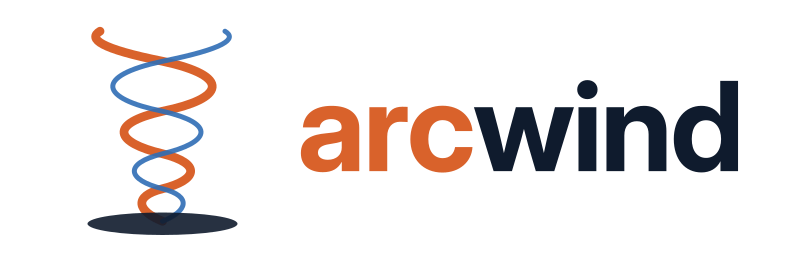
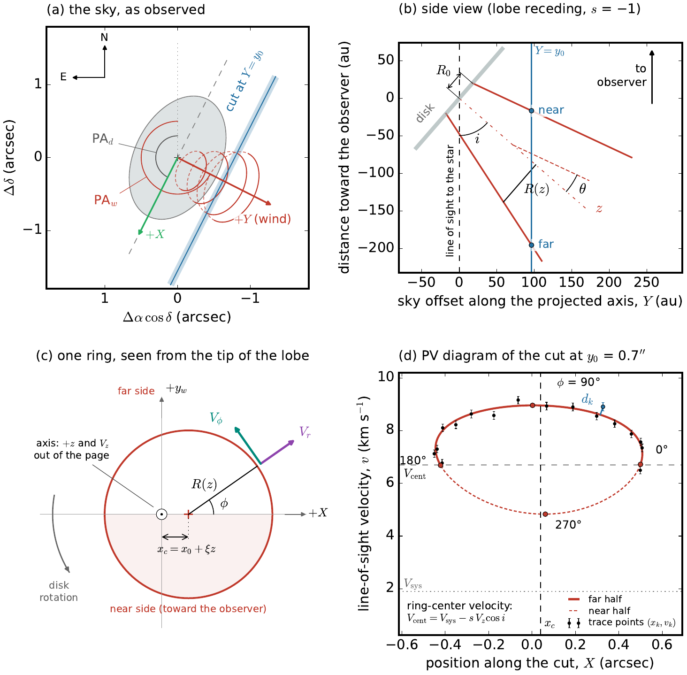

<p align="center">
  <picture>
    <source media="(prefers-color-scheme: dark)" srcset="docs/_static/logo/arcwind-banner-dark-transparent.svg">
    
  </picture>
</p>

[](https://github.com/claw-astro/arcwind/actions/workflows/tests.yml)
[](https://claw-astro.github.io/arcwind/)

**arcwind** (Analysis of Resolved Conical Winds In Nascent Disks) measures the
geometry and kinematics of protoplanetary disk winds from molecular-line cubes (e.g. ALMA CO). It fits a rotating, expanding
**conical wind** to the position–velocity (PV) diagrams of many cuts taken
perpendicular to the wind axis, and returns the cone, the velocity field, the
specific angular momentum, and the mass and mass-loss rate of the wind.



## Statement of need

Winds launched from protoplanetary disks are thought to remove mass and angular
momentum from the disk, and so to drive its accretion, evolution and dispersal.
ALMA now resolves these winds in molecular lines such as CO, as conical shells
rising above the disk. Their geometry (opening angle and launch region), velocity
field, specific angular momentum and mass-loss rate are the quantities that test
wind models, but measuring them from a line cube takes careful modeling.

The established approach (Louvet et al. 2018, for HH 30) fits the rings seen in
position-velocity diagrams of cuts across the wind, one cut at a time. It assumes
an edge-on source and complete, well-separated rings. Most disk winds do not meet
these conditions: they are seen at intermediate inclinations, often only one half
of each ring is detected, and disk or cloud emission overlaps them. Such
analyses have so far relied on source-specific scripts.

arcwind provides a general, tested and documented implementation. It fits one
wind model to all cuts at once, at any inclination, which works with partial
rings and with one or both lobes. It offers a choice of velocity, radial-velocity
and rotation laws with model comparison and bootstrap uncertainties, masks
contaminating emission, derives the mass and mass-loss rate, and makes synthetic
cubes for testing the method and planning observations.

arcwind is intended for astronomers analyzing spatially resolved line
observations of winds and outflows from young stars and their disks (ALMA,
NOEMA and similar interferometers), and for modelers who want to compare wind
models with such observations in the same framework. It has been applied to the
12CO wind of the Elias 2-20 disk.

## What it does

arcwind generalizes the method of
[Louvet et al. (2018)](https://ui.adsabs.harvard.edu/abs/2018A%26A...618A.120L)
for the edge-on HH 30 outflow:

- **any inclination** — the exact intersection of the cone with every cut is
  computed, so inclined winds can be fitted;
- **partially detected rings** — e.g. when only the red-shifted half of each ring
  is seen: one model is fitted to all cuts at once;
- **bipolar winds** — one mirror-symmetric wind fitted to both lobes, or each
  lobe on its own;
- **flexible models** — constant, power-law or broken power-law velocities (or
  your own law), flow along the cone or a free radial velocity, constant or
  height-dependent angular momentum;
- **checks and outputs** — noise and disk-rotation checks, bootstrap
  uncertainties, model comparison, mass and mass-loss rates, publication figures,
  and synthetic cubes (Elias 2-20-like and HH 30-like) to test the method.

## Installation

```bash
git clone https://github.com/claw-astro/arcwind.git
cd arcwind
pip install -e ".[all]"        # numpy, scipy, matplotlib + astropy, pyyaml, cmasher
pytest                         # ~20 s, on synthetic cubes
```

Python 3.10 or later.

## Quick start

Write a configuration and fill in the `[source]` block (cube, distance, stellar
mass, inclination, position angles):

```bash
arcwind init mysource.toml
arcwind check mysource.toml   # noise channels and disk rotation sense
arcwind run mysource.toml     # fits, mass, derived quantities, figures
```

Or step by step in Python:

```python
from arcwind import WindAnalysis

wa = WindAnalysis("mysource.toml")
first = wa.fit("power-law", n_boot=0)                     # quick first fit
final = wa.fit("broken-power-law", guide=first,           # traces around it
               start_from=first, iterations=2)
wa.compare(first, final)                                  # chi2 and BIC
print(final.summary())

mass = wa.mass(final)
print(wa.derived(final, mass).summary())                  # Vp, launch radius, Mdot ...
wa.plot_cuts(final, others=[first])                       # every cut with the model
```

Every option can be set in the configuration file, on the configuration object,
or for one call — `arcwind options` lists them all:

```python
wa.fit(radial="proportional", fixed={"xslope": 0.0}, loss="soft_l1", lobe="both")
```

No data at hand? `arcwind mock` (or `arcwind mock --preset hh30`) writes a
synthetic cube and a matching configuration.

## Examples

| | |
|---|---|
| [`01_quickstart_mock.py`](examples/01_quickstart_mock.py) | a synthetic wind, fitted and compared with the truth |
| [`02_elias20_analysis.py`](examples/02_elias20_analysis.py) | the Elias 2-20 analysis, step by step |
| [`03_fitting_options.py`](examples/03_fitting_options.py) | every fitting option, on and off |
| [`04_custom_velocity_law.py`](examples/04_custom_velocity_law.py) | your own velocity law |
| [`05_ring_fits_full_rings.py`](examples/05_ring_fits_full_rings.py) | per-cut ring fits (Louvet et al. 2018) |
| [`06_low_level_api.py`](examples/06_low_level_api.py) | the building blocks |
| [`07_hh30_like_both_lobes.py`](examples/07_hh30_like_both_lobes.py) | an HH 30-like bipolar wind |
| [`08`–`10`](examples/) | schematic figures of the model |
| [`11_elias20_cut_range_test.py`](examples/11_elias20_cut_range_test.py) | Elias 2-20: all cuts vs cuts up to y = 2.0" |

## Documentation

The documentation (concepts, the analysis step by step, every fitting option,
the configuration reference, tutorials and the API) is in [`docs/`](docs/) and
is published at **https://claw-astro.github.io/arcwind/** (or Read the Docs).
Build it locally with:

```bash
pip install -e ".[docs]"
sphinx-build docs docs/_build/html
```

## Repository layout

```
src/arcwind/     the package
  config.py         settings (WindConfig)          cube.py      cube and PV diagrams
  masks.py          contamination masks            trace.py     trace extraction
  laws.py           velocity laws                  model.py     the conical wind
  fitting.py        global fit and results         ringfit.py   per-cut ring fits
  mass.py           mass and mass-loss rate        derived.py   derived quantities
  continuum.py      disk center from continuum     diagnostics.py  noise and rotation checks
  mock.py           synthetic cubes                analysis.py  WindAnalysis (all steps)
  plotting/         figures                        cli.py       the `arcwind` command
examples/         runnable examples and configurations
docs/             Sphinx documentation
tests/            pytest suite
```

## Citing

Please cite Louvet et al. (2018, A&A 618, A120), whose method arcwind
generalizes.

## Contributing, support and governance

Questions, bug reports and contributions are welcome through the
[issue tracker](https://github.com/claw-astro/arcwind/issues).

- [CONTRIBUTING.md](CONTRIBUTING.md): how to report a problem, set up a
  development copy, and propose a change (tests, style, pull requests).
- [SUPPORT.md](SUPPORT.md): where to get help and what response to expect.
- [GOVERNANCE.md](GOVERNANCE.md): who maintains the package and how decisions
  and releases are made.
- [CODE_OF_CONDUCT.md](CODE_OF_CONDUCT.md): the Code of Conduct.

## Acknowledgments

Portions of this package—including initial scaffolding, unit tests, code
refactoring, figure generation, and documentation—were developed with assistance
from Claude (Opus 5.5) by Anthropic. All code has been reviewed and tested by the
maintainers. The human authors reviewed, edited and validated all AI-assisted
outputs, and made the core design decisions: the scientific method, the wind
model and its parameterization, the fitting and uncertainty strategy, and the
structure and interfaces of the package.

## License

MIT — see [LICENSE](LICENSE).
