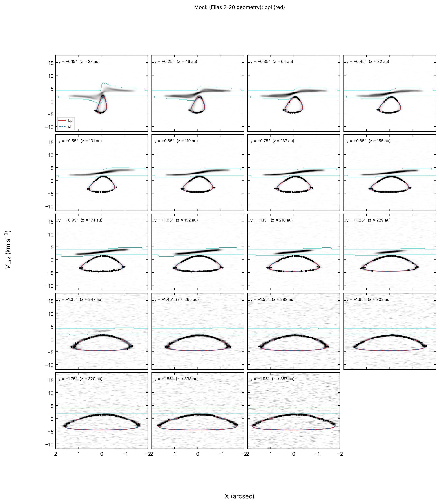

Tutorial: a synthetic wind
==========================

This tutorial makes a synthetic cube with known parameters, fits it, and checks
the result (``examples/01_quickstart_mock.py``).

.. code-block:: python

   from diskwind import WindAnalysis
   from diskwind.mock import MockWind, make_mock_cube

   truth = MockWind(theta_deg=30.0, vp=8.0, j=-40.0)   # i = 49 deg, full rings
   make_mock_cube("mock_cube.fits", truth)
   cfg = truth.config("mock_cube.fits")                 # matching WindConfig
   cfg.fit.n_boot = 0
   cfg.save("mock.toml")

   wa = WindAnalysis(cfg)
   print(wa.cube)

The cube printout reports what was estimated: Vsys (3.0), the lobe orientation
(approaching, ``s = +1``) and the disk rotation sense (-1).

.. code-block:: python

   res = wa.fit("constant", radial="cone")
   print(res.summary())

recovers theta = 29.8 deg (true 30), Vz = 6.92 km/s (6.93) and
j = -41 au km/s (-40).

   ``wa.plot_cuts(res)``: every cut with its trace (black) and the model.

Things to try
-------------

* Hide one half of each ring (``cfg.mask.vrel_range_kms``) and set
  ``trace.mode = "single"``: how much do the parameters change?
* Fit ``radial="proportional"`` and compare the flow angle with the cone angle.
* Make the wind accelerate (edit ``vp`` per height in your own copy of
  :func:`~diskwind.mock.make_mock_cube`) and fit a power law.
