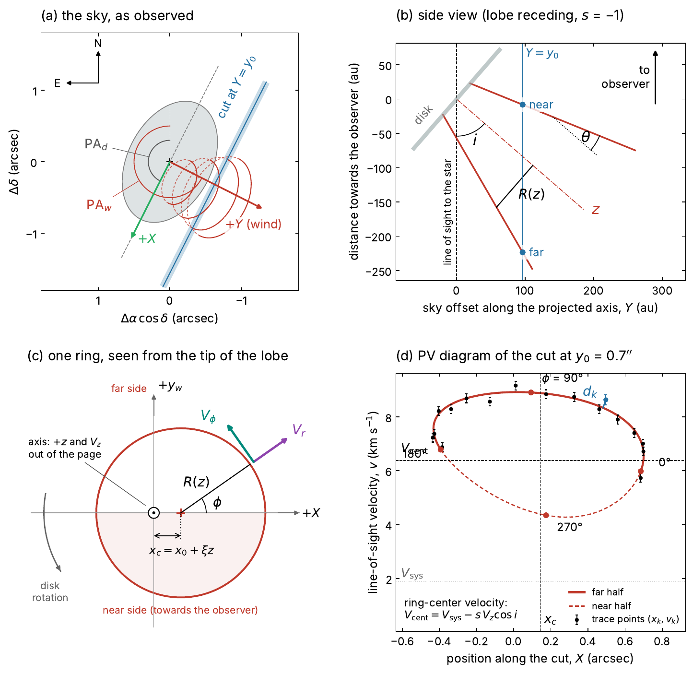

# diskwind

[](https://github.com/USERNAME/diskwind/actions/workflows/tests.yml)
[](https://USERNAME.github.io/diskwind/)

**diskwind** measures the geometry and kinematics of protoplanetary disk winds
from molecular-line cubes (e.g. ALMA CO). It fits a rotating, expanding
**conical wind** to the position–velocity (PV) diagrams of many cuts taken
perpendicular to the wind axis, and returns the cone, the velocity field, the
specific angular momentum, and the mass and mass-loss rate of the wind.



## What it does

diskwind generalizes the method of
[Louvet et al. (2018)](https://ui.adsabs.harvard.edu/abs/2018A%26A...618A.120L)
for the edge-on HH 30 outflow:

- **any inclination** — the exact intersection of the cone with every cut is
  computed, so inclined winds can be fitted;
- **partially detected rings** — e.g. when only the red-shifted half of each ring
  is seen: one model is fitted to all cuts at once;
- **bipolar winds** — one mirror-symmetric wind fitted to both lobes, or each
  lobe on its own;
- **flexible models** — constant, power-law or broken power-law velocities (or
  your own law), flow along the cone or a free radial velocity, constant or
  height-dependent angular momentum;
- **checks and outputs** — noise and disk-rotation checks, bootstrap
  uncertainties, model comparison, mass and mass-loss rates, publication figures,
  and synthetic cubes (Elias 2-20-like and HH 30-like) to test the method.

## Installation

```bash
git clone https://github.com/USERNAME/diskwind.git
cd diskwind
pip install -e ".[all]"        # numpy, scipy, matplotlib + astropy, pyyaml, cmasher
pytest                         # ~20 s, on synthetic cubes
```

Python 3.8 or later (3.10+ recommended).

## Quick start

Write a configuration and fill in the `[source]` block (cube, distance, stellar
mass, inclination, position angles):

```bash
diskwind init mysource.toml
diskwind check mysource.toml   # noise channels and disk rotation sense
diskwind run mysource.toml     # fits, mass, derived quantities, figures
```

Or step by step in Python:

```python
from diskwind import WindAnalysis

wa = WindAnalysis("mysource.toml")
first = wa.fit("power-law", n_boot=0)                     # quick first fit
final = wa.fit("broken-power-law", guide=first,           # traces around it
               start_from=first, iterations=2)
wa.compare(first, final)                                  # chi2 and BIC
print(final.summary())

mass = wa.mass(final)
print(wa.derived(final, mass).summary())                  # Vp, launch radius, Mdot ...
wa.plot_cuts(final, others=[first])                       # every cut with the model
```

Every option can be set in the configuration file, on the configuration object,
or for one call — `diskwind options` lists them all:

```python
wa.fit(radial="proportional", fixed={"xslope": 0.0}, loss="soft_l1", lobe="both")
```

No data at hand? `diskwind mock` (or `diskwind mock --preset hh30`) writes a
synthetic cube and a matching configuration.

## Examples

| | |
|---|---|
| [`01_quickstart_mock.py`](examples/01_quickstart_mock.py) | a synthetic wind, fitted and compared with the truth |
| [`02_elias20_analysis.py`](examples/02_elias20_analysis.py) | the Elias 2-20 analysis, step by step |
| [`03_fitting_options.py`](examples/03_fitting_options.py) | every fitting option, on and off |
| [`04_custom_velocity_law.py`](examples/04_custom_velocity_law.py) | your own velocity law |
| [`05_ring_fits_full_rings.py`](examples/05_ring_fits_full_rings.py) | per-cut ring fits (Louvet et al. 2018) |
| [`06_low_level_api.py`](examples/06_low_level_api.py) | the building blocks |
| [`07_hh30_like_both_lobes.py`](examples/07_hh30_like_both_lobes.py) | an HH 30-like bipolar wind |
| [`08`–`10`](examples/) | schematic figures of the model |

## Documentation

The documentation (concepts, the analysis step by step, every fitting option,
the configuration reference, tutorials and the API) is in [`docs/`](docs/) and
is published at **https://USERNAME.github.io/diskwind/** (or Read the Docs).
Build it locally with:

```bash
pip install -e ".[docs]"
sphinx-build docs docs/_build/html
```

## Repository layout

```
src/diskwind/     the package
  config.py         settings (WindConfig)          cube.py      cube and PV diagrams
  masks.py          contamination masks            trace.py     trace extraction
  laws.py           velocity laws                  model.py     the conical wind
  fitting.py        global fit and results         ringfit.py   per-cut ring fits
  mass.py           mass and mass-loss rate        derived.py   derived quantities
  continuum.py      disk center from continuum     diagnostics.py  noise and rotation checks
  mock.py           synthetic cubes                analysis.py  WindAnalysis (all steps)
  plotting/         figures                        cli.py       the `diskwind` command
examples/         runnable examples and configurations
docs/             Sphinx documentation
tests/            pytest suite
```

## Citing

Please cite the Elias 2-20 wind paper (Law et al., in preparation) and
Louvet et al. (2018, A&A 618, A120), whose method diskwind generalizes.

## License

MIT — see [LICENSE](LICENSE).
