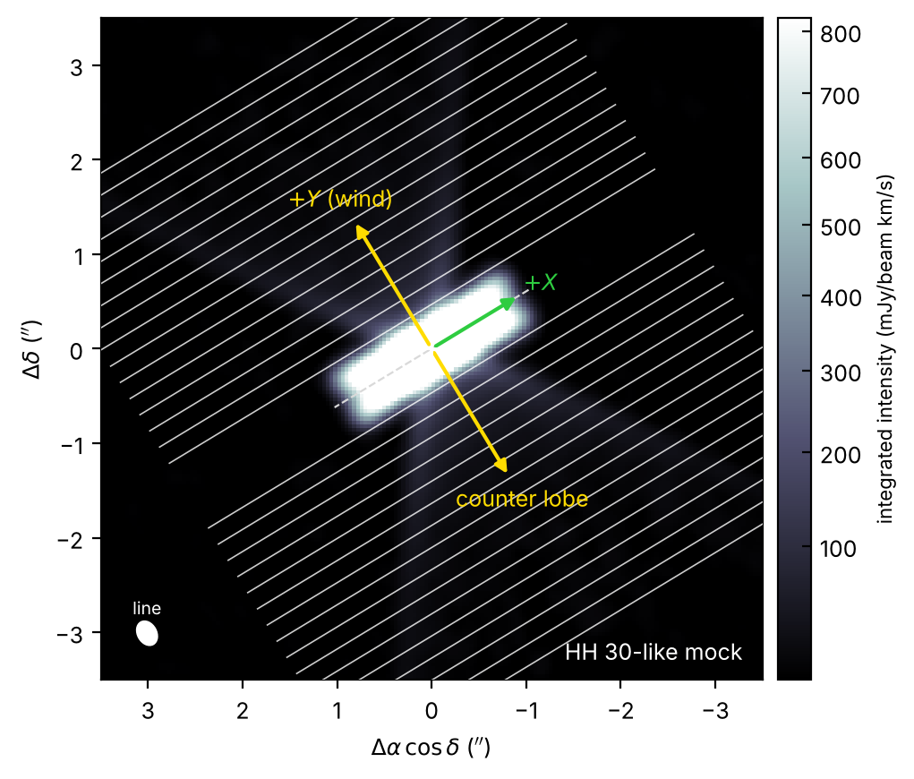
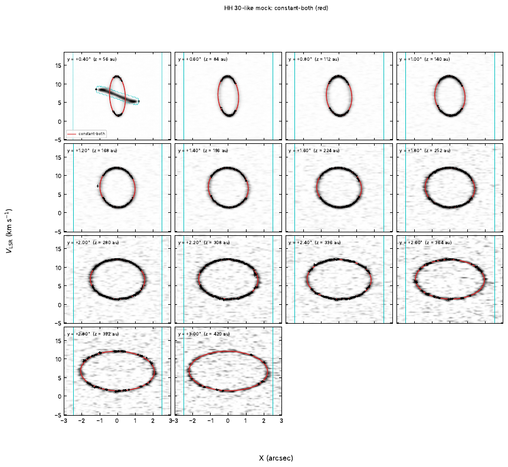

Tutorial: an HH 30-like bipolar wind
====================================

This tutorial fits both lobes of a nearly edge-on bipolar wind, using a synthetic
cube with the parameters that Louvet et al. (2018) measured for HH 30
(``examples/07_hh30_like_both_lobes.py``; about 5 minutes, no data needed).

The HH 30-like preset
---------------------

:meth:`MockWind.hh30_like() <diskwind.mock.MockWind.hh30_like>` builds the
disk and wind below. Any of these values can be changed with keyword arguments,
e.g. ``MockWind.hh30_like(j=0.0)``.

.. list-table::
   :header-rows: 1
   :widths: 40 30 30

   * - Quantity
     - HH 30-like mock
     - Louvet et al. (2018)
   * - distance, stellar mass, Vsys
     - 140 pc, 0.45 Msun, 6.9 km/s
     - same
   * - wind axis
     - PA 31.2 deg, i = 89 deg (main lobe tilted away)
     - PA 31.2 deg, i = 91 deg
   * - cone half-opening angle, R0
     - 35 deg, 20 au
     - ~35 deg, R0 <= 22 au
   * - poloidal speed
     - 9.3 km/s, constant
     - 9.3 +/- 0.7 km/s, constant
   * - specific angular momentum
     - 38 au km/s, with the disk
     - 38 +/- 15 au km/s, with the disk
   * - lobes
     - both, mirror-symmetric
     - both
   * - beam, channels
     - 0.26" x 0.19" (PA 29 deg), 0.3 km/s
     - same
   * - CO disk
     - Keplerian, r <= 150 au, z/r <= 0.2
     - r ~ 145 au (continuum)

An inclination of 91 deg is the same view as 89 deg with the lobe tilted the
other way; diskwind uses 0-90 deg and the lobe orientation
(``wind_approaching``). Close to edge-on, the tilt and the disk rotation sense
cannot be estimated reliably from the cube, so the mock configuration states
them, as one would from the jet or scattered-light images.

.. code-block:: python

   from diskwind import WindAnalysis
   from diskwind.mock import MockWind, make_mock_cube

   truth = MockWind.hh30_like()
   make_mock_cube("hh30_mock.fits", truth)
   cfg = truth.config("hh30_mock.fits")     # source.lobes = "both"
   wa = WindAnalysis(cfg)
   wa.plot_slit_layout()                    # cuts on both sides of the disk

   The HH 30-like mock: integrated intensity, with the cuts of both lobes.

Fitting both lobes
------------------

With ``lobe="both"`` (or ``source.lobes = "both"`` in the configuration), the
cuts of both lobes are extracted, each lobe in its own frame, and **one**
mirror-symmetric wind is fitted to all of them:

.. code-block:: python

   both = wa.fit("constant", lobe="both")
   print(both.summary())

On the mock (28 cuts, 14 per lobe) this recovers theta = 34.2 deg (true 35),
Vp = 9.5 km/s (true 9.3) and j = 39 au km/s (true 38). The parameters refer to the main
lobe's frame. ``both.view("counter")`` gives the same result in the counter
lobe's frame, which is what the figures of the counter lobe use:

.. code-block:: python

   wa.plot_cuts(both, lobe="main")
   wa.plot_cuts(both, lobe="counter")

   The counter lobe, in its own frame, with the two-lobe model (red) and the
   traces (black).

Is the speed constant? A power law fitted to the same cuts gives
``qv = 0.007``: the speed is constant, as in the mock. Its formal BIC is lower
nonetheless (Delta BIC ~ 80), because the trace points oversample the beam --
judge such comparisons by the size of the change, not by the BIC alone:

.. code-block:: python

   pl = wa.fit("power-law", lobe="both", start_from=both)
   wa.compare(both, pl)

Each lobe on its own
--------------------

Fitting the lobes separately tests whether the wind is really symmetric:

.. code-block:: python

   north = wa.fit("constant", lobe="main")
   south = wa.fit("constant", lobe="counter")
   south.view("main").params        # in the main lobe's sign conventions

On the mock, the main lobe gives theta = 33.9 deg, Vz = 7.92 km/s and
j = +40 au km/s, the counter lobe 34.5 deg, 7.74 km/s and +38 au km/s.

In its own frame the counter lobe has ``xoff_au`` and ``j`` of the opposite sign
(:ref:`two-lobes`); ``view("main")`` converts them, so the two sets of
parameters can be compared directly.

Per-cut ring fits
-----------------

Because both halves of every ring are detected, each cut can also be fitted on
its own, as in Louvet et al. (2018); see :doc:`ring_fits`:

.. code-block:: python

   rings = wa.ring_fits(lobe="main")
   rings.cone                        # R0 and theta from R(z)

On the mock the ring radii give R0 = 18.7 +/- 1.6 au and theta = 34.9 +/- 0.2 deg.

Mass
----

Masses are computed per lobe:

.. code-block:: python

   m_main = wa.mass(both, lobe="main")
   m_counter = wa.mass(both, lobe="counter")
