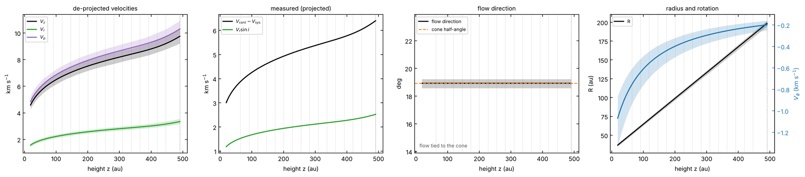
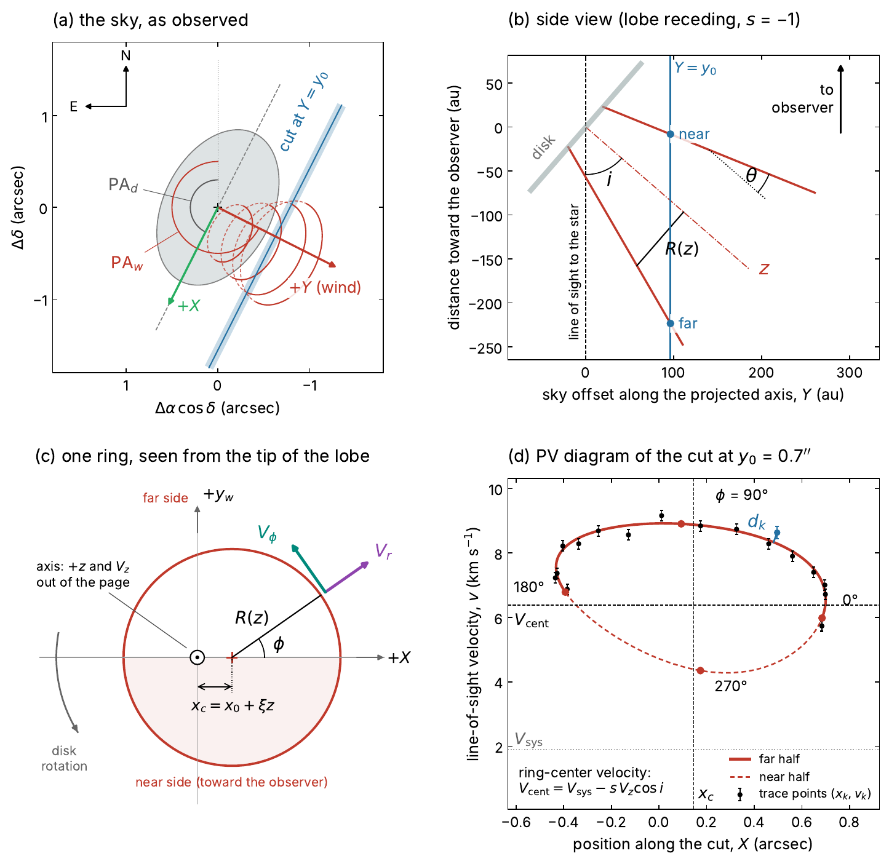
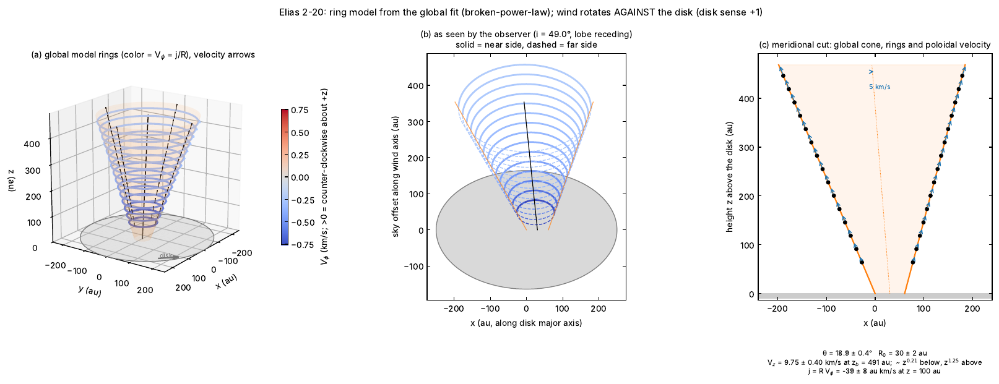

Tutorial: Elias 2-20
====================

The adopted analysis of the Elias 2-20 wind (DSHARP 12CO 2-1), in
``examples/02_elias20_analysis.py`` with ``examples/configs/elias20.toml``.

What is special
---------------

* Only the red-shifted, far half of each ring is detected; the near half falls
  in the velocity range absorbed by the Ophiuchus cloud.
  -> ``trace.mode = "single"``, ``mask.vrel_range_kms = [4.1, 12.1]``.
* The flow is tied to the cone (``fit.radial = "cone"``).
* A spatial window that follows the wind (``mask.x_cone``) excludes a faint, flat
  component; the highest cuts have their own overrides (wider slits, smoothing,
  a lower S/N threshold, an asymmetric guide window).
* Every cut has the same weight and a robust loss is used
  (``equal_cut_weight = true``, ``loss = "soft_l1"``).
* The noise is measured from 5 channels at each end of the cube
  (``noise.n_edge_channels = 5``); ``check_noise()`` tests the red end, which
  the wind approaches.

Steps
-----

.. code-block:: python

   from diskwind import WindAnalysis
   wa = WindAnalysis("configs/elias20.toml")
   print(wa.check_noise().summary())
   print(wa.check_disk_rotation().summary())        # +1: the SE side is red-shifted

   pl = wa.fit("power-law", n_boot=0, label="power-law-first")
   bpl = wa.fit("broken-power-law", guide=pl, start_from=pl, iterations=2, n_boot=100)
   wa.compare(pl, bpl)

   mass = wa.mass(bpl)
   print(wa.derived(bpl, mass).summary())

The adopted parameters (bootstrap run of the original scripts) were
theta = 18.9 +/- 0.4 deg, R0 = 30 +/- 2 au, j = -39 +/- 9 au km/s (the wind
rotates against the disk), Vz,b = 9.75 +/- 0.41 km/s at z_b = 491 +/- 28 au,
q1 = 0.21 +/- 0.02 and q2 = 1.25 +/- 0.34.

   ``wa.plot_profiles(bpl)`` for the adopted broken power law: the wind speeds
   up with height (q1 = 0.21 below the break; the dotted line is z_b, near the
   highest cut). The flow follows the cone (theta = 18.9 deg), and the rotation
   velocity (blue) is negative: the wind rotates against the disk.

Schematic figures
-----------------

``examples/08_model_definitions.py``, ``09_model_definitions_meridional.py`` and
``10_ring_schematic.py`` draw the schematics of the model (definitions of the
variables, and the fitted rings in 3-D) from the saved
``broken-power-law.json``.

   ``08_model_definitions.py``: the variables of the model.

   ``10_ring_schematic.py``: the fitted rings drawn in 3-D.
