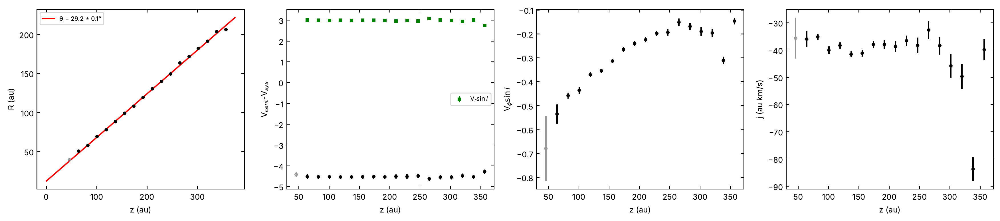

Tutorial: per-cut ring fits (full rings)
========================================

When both halves of every ring are detected -- as for the edge-on HH 30 --
each cut can be fitted on its own with an ellipse-like ring
(Louvet et al. 2018, Sect. 4.4), giving the radius and velocities at each height
without assuming a velocity law (``examples/05_ring_fits_full_rings.py``).

.. code-block:: python

   rings = wa.ring_fits()              # RingFitSet
   rings.cone                          # R0, theta from a fit to R(z)
   t = rings.table()                   # columns: z_au, R_au, Vz, Vr, Vphi, j (+ _err)

   from diskwind.plotting import plot_ring_fits
   plot_ring_fits(rings)

   ``plot_ring_fits`` on the synthetic wind (true theta = 30 deg). From left: the
   radius with the cone fit; the ring-center velocity and Vr sin i; the rotation
   velocity; the specific angular momentum. Gray points are flagged
   (e.g. rings too small for the beam).

Without ``ring.cone_half_angle_deg`` the fits run in two passes: every cut with
theta free, a straight-line fit to R(z), then every cut again with theta fixed.
For each cut ``trace.mode = "wings"`` splits the blue and red wings at the fitted
mid-line and refits.

Combining with a global fit:

.. code-block:: python

   g = wa.fit(n_boot=0)
   rings = wa.ring_fits(prior_from=g)   # Gaussian priors on Vcent and Vr sin i
   rings = wa.ring_fits(fix_from=g)     # or fixed to the global model

With partial rings the per-cut fits are degenerate (``coverage`` < 0.6 flags
them): use the global fit.
