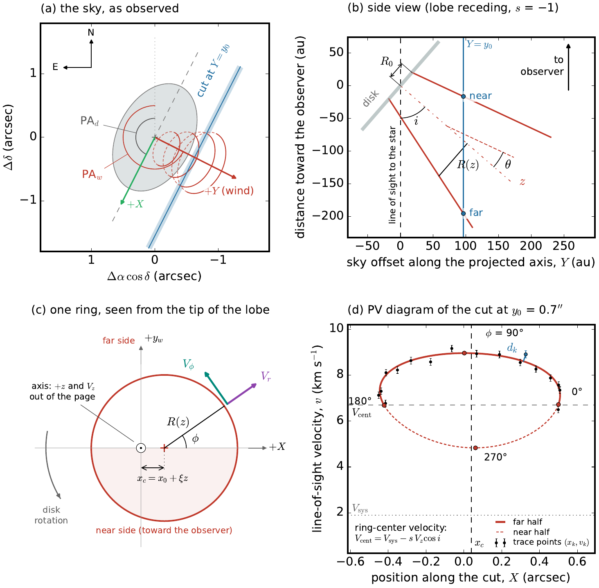

Concepts and conventions
========================

   Definitions of the model, drawn for the adopted fit of Elias 2-20
   (:download:`PDF <_static/model_definitions.pdf>`; made with
   ``examples/08_model_definitions.py``).
   (a) The cuts on the sky; (b) side view: a cut meets the near and far sides of
   the cone at different heights; (c) one ring and its velocity components;
   (d) the resulting curve in the PV diagram of a cut.

Frames
------

``X, Y``
   Sky offsets from the disk center. ``Y`` runs along the projected wind axis,
   toward the lobe (position angle ``wind_pa_deg``); ``X`` is perpendicular to it,
   toward ``wind_pa_deg - 90`` (the disk major axis).
``z, R, phi``
   Height along the wind axis, distance from the axis, and azimuth about ``+z``,
   counted counter-clockwise from ``+X`` seen from the tip of the lobe.
``i, s``
   The inclination of the axis to the line of sight (0-90 deg), and the lobe
   orientation: ``s = +1`` if the axis is tilted toward the observer (lobe
   blue-shifted on average), ``-1`` if away.
Disk rotation sense
   ``+1`` if the disk rotates counter-clockwise about ``+z`` (its ``+X`` side is
   red-shifted). A wind with ``j > 0`` then rotates with the disk.

The model
---------

The wind is a thin conical shell whose axis may be offset and tilted along X:

.. math::

   R(z) = R_0 + z\tan\theta, \qquad x_c(z) = x_0 + \xi z .

The gas has an axial velocity :math:`V_z(z)` (the :mod:`velocity law
<arcwind.laws>`), a radial velocity :math:`V_r(z)` and a rotation
:math:`V_\phi = j(z)/R`. A point of the ring at height :math:`z` and azimuth
:math:`\phi` is seen at

.. math::

   X = x_c + R\cos\phi, \qquad Y = z\sin i + sR\sin\phi\cos i,

with line-of-sight velocity

.. math::

   v - V_{\rm sys} = -sV_z\cos i + V_r\sin i\sin\phi + V_\phi\sin i\cos\phi .

Each ring is an ellipse on the sky, centered at :math:`Y = z\sin i`. A cut at
fixed :math:`Y = y_0` therefore meets the cone at heights that depend on
azimuth,

.. math::

   z(\phi) = \frac{y_0 - sR_0\sin\phi\cos i}{\sin i + s\tan\theta\sin\phi\cos i},

which requires :math:`\tan\theta < \tan i` (the fit allows up to
:math:`0.95\tan i`). Substituting :math:`z(\phi)` gives the **model curve** of
the cut in the PV diagram: an ellipse for an edge-on source (Louvet et al.
2018, their App. B), a distorted closed curve otherwise.

The fit
-------

In each PV diagram the locus of the emission (the **trace**) is measured by
Gaussian fits to the spectrum at every position (:mod:`arcwind.trace`). The
model is compared with the trace points of all cuts through their normalized
orthogonal distance to the model curve,

.. math::

   d_k^2 = \min_\phi\left[\left(\frac{x_k - X(\phi)}{\sigma_x}\right)^2 +
   \left(\frac{v_k - v(\phi)}{\sigma_k}\right)^2\right],

and :math:`\sum_k\rho(w_k^2d_k^2)` is minimized (:mod:`arcwind.fitting`).
For points traced along velocity, :math:`\sigma_k` is the velocity error of the
Gaussian centroid and :math:`\sigma_x` a fraction of the beam. With
``trace.mode = "ring"`` the steep walls of tall rings are also traced along
position in each channel; for those points the roles swap, with a position error
from the centroid along X and a velocity error of half the (smoothed) channel
width. Both kinds of point enter the same sum.
Uncertainties come from the covariance matrix and from refits to resampled cuts:
a bootstrap (cuts drawn with replacement) or a jackknife (one cut left out at a
time). The refits run in parallel.

.. _two-lobes:

Two lobes
---------

A bipolar wind has a **main** lobe (along ``wind_pa_deg``) and a **counter**
lobe (along ``wind_pa_deg + 180``). arcwind analyzes the counter lobe in its own
wind frame, turned by 180 deg: ``+Y`` points along the counter lobe and ``X`` is
reversed. In that frame the counter lobe looks like any single lobe, except that
its axis is tilted the other way (``s -> -s``) and, seen about its own axis, the
disk rotates the other way (``disk sense -> -disk sense``).

A mirror-symmetric wind has the same cone and velocities in both lobes and
rotates in the same physical sense. In the counter lobe's frame, the axis offset
``xoff_au`` and the specific angular momentum ``j`` therefore change sign; the
cone, the velocities and the axis tilt ``xslope`` do not. "With the disk" still
means ``j x disk sense > 0`` in either frame.

* ``source.lobes = "main"`` / ``"counter"``: analyze one lobe.
* ``source.lobes = "both"`` (or ``wa.fit(lobe="both")``): fit one wind to the
  cuts of both lobes, with parameters in the main lobe's frame.
* ``result.view("counter")``: the same result in the counter lobe's frame.

See :doc:`tutorials/hh30_like`.

Why tie the flow to the cone?
-----------------------------

When only half of each ring is detected, the top of each arch constrains only
:math:`V_z\cos i + V_r\sin i`; with :math:`V_r` free the fit can find
unphysical solutions (gas moving toward the axis, or sideways expansion with
:math:`V_z\approx0`). ``radial = "cone"`` (:math:`V_r = V_z\tan\theta`, as in
Louvet et al. 2018) removes this degeneracy. With full rings, ``radial =
"proportional"`` lets the data measure the flow direction.

Limitations
-----------

* :math:`R_0` is extrapolated below the lowest cut; it is not a launch radius.
* The wind axis is assumed to share the disk inclination.
* Trace points are spaced by half a beam along the cut (``trace.dx_arcsec``), so
  neighboring points are not independent: chi2 and BIC differences are
  overestimated by about a factor of 2.
* With partial rings, test the method on a synthetic cube with your geometry
  (:mod:`arcwind.mock`): biases can exceed the statistical errors.
