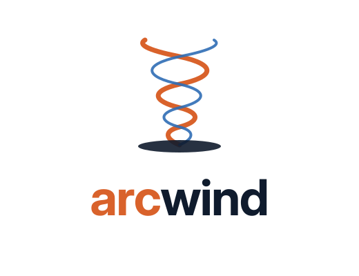
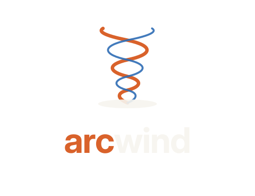

arcwind
========

**arcwind** (Analysis of Resolved Conical Winds In Nascent Disks) measures the geometry and kinematics of protoplanetary disk winds
from line cubes (e.g. ALMA CO), by fitting a rotating, expanding conical wind to
the position--velocity (PV) diagrams of many cuts perpendicular to the wind axis.

It generalizes the method of `Louvet et al. (2018)
<https://ui.adsabs.harvard.edu/abs/2018A%26A...618A.120L>`_ for the edge-on HH 30
outflow to

* **any inclination**: a cut no longer samples a single height, so the exact
  intersection of the cone with every cut is computed;
* **partially detected rings** (e.g. only the red-shifted half): one model is
  fitted to all cuts at once;
* **bipolar winds**: one mirror-symmetric wind fitted to both lobes, or each lobe
  on its own;
* **flexible velocity laws** (constant, power law, broken power law, or your own),
  radial-velocity and rotation laws, all switchable from a configuration file.

.. rubric:: Statement of need

Winds launched from protoplanetary disks are thought to remove mass and angular
momentum from the disk, and so to drive its accretion, evolution and dispersal.
ALMA now resolves these winds in molecular lines such as CO, as conical shells
rising above the disk. Their geometry (opening angle and launch region), velocity
field, specific angular momentum and mass-loss rate are the quantities that test
wind models, but measuring them from a line cube takes careful modeling.

The established approach (Louvet et al. 2018, for HH 30) fits the rings seen in
position-velocity diagrams of cuts across the wind, one cut at a time. It assumes
an edge-on source and complete, well-separated rings. Most disk winds do not meet
these conditions: they are seen at intermediate inclinations, often only one half
of each ring is detected, and disk or cloud emission overlaps them. Such
analyses have so far relied on source-specific scripts.

arcwind provides a general, tested and documented implementation. It fits one
wind model to all cuts at once, at any inclination, which works with partial
rings and with one or both lobes. It offers a choice of velocity, radial-velocity
and rotation laws with model comparison and bootstrap uncertainties, masks
contaminating emission, derives the mass and mass-loss rate, and makes synthetic
cubes for testing the method and planning observations.

arcwind is intended for astronomers analyzing spatially resolved line
observations of winds and outflows from young stars and their disks (ALMA,
NOEMA and similar interferometers), and for modelers who want to compare wind
models with such observations in the same framework. It has been applied to the
:sup:`12`\ CO wind of the Elias 2-20 disk.

.. code-block:: python

   from arcwind import WindAnalysis

   wa = WindAnalysis("mysource.toml")
   wa.check_noise(); wa.check_disk_rotation()
   first = wa.fit("power-law", n_boot=0)
   final = wa.fit("broken-power-law", guide=first, start_from=first)
   print(final.summary())
   wa.plot_cuts(final)

.. toctree::
   :maxdepth: 2
   :caption: Getting started

   installation
   quickstart
   concepts

.. toctree::
   :maxdepth: 2
   :caption: User guide

   workflow
   fitting_options
   configuration
   outputs
   faq

.. toctree::
   :maxdepth: 1
   :caption: Tutorials

   tutorials/mock
   tutorials/hh30_like
   tutorials/custom_law
   tutorials/ring_fits
   tutorials/elias20

.. toctree::
   :maxdepth: 2
   :caption: Reference

   api/index
   cli
   citing
   contributing
   changelog
