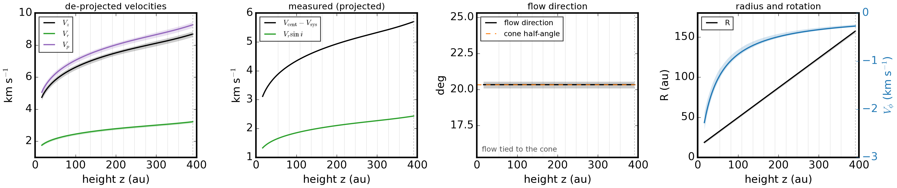
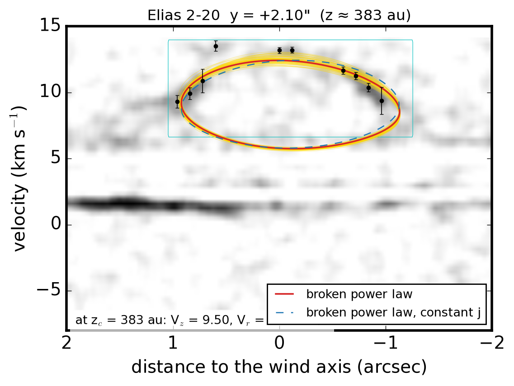
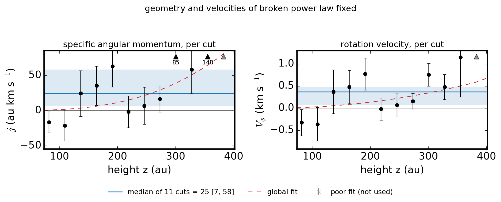
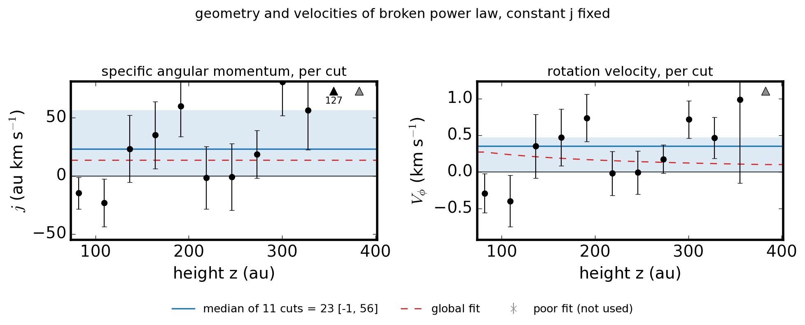
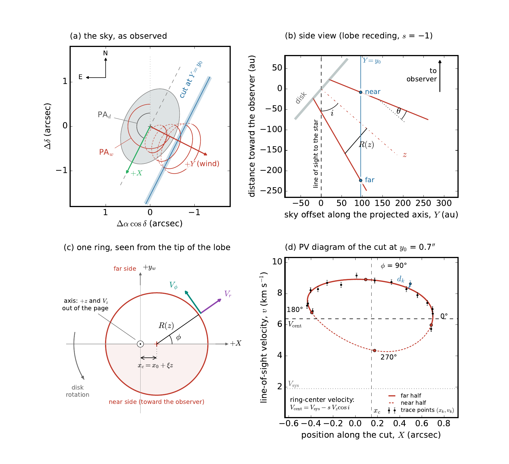
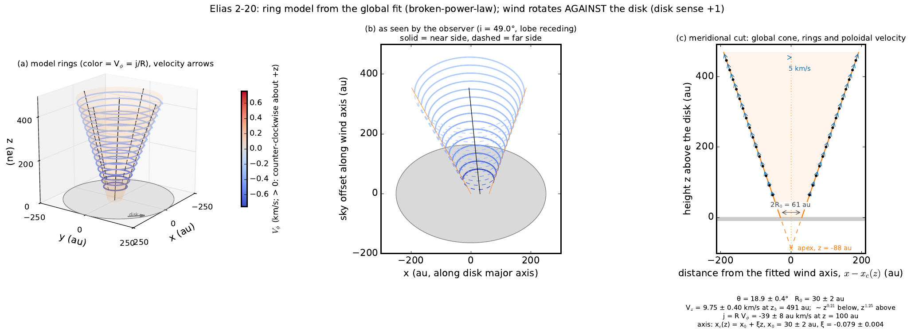

Real application: Elias 2-20
============================

This last tutorial applies everything above to real ALMA data: the adopted
analysis of the Elias 2-20 wind (DSHARP 12CO 2-1), in
``examples/02_elias20_analysis.py`` with ``examples/configs/elias20.toml``.

What is special
---------------

* Only the red-shifted, far half of each ring is detected; the near half falls
  in the velocity range absorbed by the Ophiuchus cloud.
  -> ``trace.mode = "single"``, ``mask.vrel_range_kms = [4.1, 12.1]``.
* The flow is tied to the cone (``fit.radial = "cone"``).
* The adopted global fit lets j change with height, j(z) = j (z / 100 au)^qj
  (``fit.rotation = "power-law"``); a constant j (``"constant"``) is fitted to the
  same traces for comparison. Either way, the rotation itself is measured cut by
  cut (below).
* Two arcs are seen at y ~ 0.5-1.5": a bright inner arch and a fainter, wider
  outer arc. The spatial window ``mask.x_cone = [0.19, 0.10, 0.50, -0.14]``
  (center 0.19 - 0.14 y, half-width 0.10 + 0.50 y arcsec) follows the inner
  arch; a wider window mixes the two shells and makes the single-shell fit too
  wide at mid heights.
* Cuts from y = 0.45" to 2.40", every 0.15". Below 0.45" the arch is barely wider
  than the window and one of its legs is cut off, which leaves the radius and
  the rotation of the lowest cut unconstrained. The highest cuts (y >= 1.95") have
  their own overrides (narrower slits, smoothing, a lower S/N threshold, an
  asymmetric guide window).
* Every cut has the same weight and a robust loss is used
  (``equal_cut_weight = true``, ``loss = "soft_l1"``).
* The noise is measured from 5 channels at each end of the cube
  (``noise.n_edge_channels = 5``); ``check_noise()`` tests the red end, which
  the wind approaches.

Steps
-----

.. code-block:: python

   from diskwind import WindAnalysis
   wa = WindAnalysis("configs/elias20.toml")
   print(wa.check_noise().summary())
   print(wa.check_disk_rotation().summary())        # +1: the SE side is red-shifted

   start = wa.fit("power-law", n_boot=0, label="power-law-first")   # from scratch
   bpl = wa.fit("broken-power-law", guide=start, start_from=start, iterations=2)
   pl = wa.fit("power-law", traces=bpl.traces, start_from=bpl, n_boot=0)
   wa.compare(pl, bpl)                                # same traces for both laws

   # the same traces with one constant j, for comparison
   bpl_c = wa.fit("broken-power-law", rotation="constant", traces=bpl.traces,
                  start_from=bpl, label="broken-power-law-constj")
   wa.compare(bpl_c, bpl)
   rot = wa.rotation_per_cut(bpl)                   # j measured cut by cut
   print(rot.summary())
   wa.plot_rotation(rot, result=bpl)

   mass = wa.mass(bpl)
   print(wa.derived(bpl, mass).summary())

More than one solution
----------------------

With half rings, the global fit has more than one self-consistent solution, and
the guided traces keep a fit in the solution it starts from. In earlier setups a fit
started from an earlier adopted fit and one started from scratch differed in theta
(~20 vs ~17 deg) and in j (~-45 vs ~0 au km/s). The geometry and the velocity law
are the robust part; the rotation is not (below). Compare solutions on traces
extracted without a guide (``wa.extract_traces()``, ``result.chi2_on(traces)``).
Examples 02 and 11 start every fit from scratch.

   ``wa.plot_profiles(bpl)`` for a broken power law fitted to the inner arch
   (cuts y <= 2.0"): the wind speeds up with height below the break (the dotted
   line, at the top of the traced region). The flow follows the cone.

Rotation: j(z) or a constant j
------------------------------

Two global descriptions of the rotation are available, and example 02 fits both to
the same traces (``CONSTANT_J = True``):

``fit.rotation = "power-law"`` (adopted)
   j(z) = j (z / 100 au)^qj. For Elias 2-20 (cuts 0.45-2.40") j(100 au) = 1.4 +-
   2.2 au km/s and qj = 3, at its upper bound: the law is pushed by the faint top
   cuts, where it gives the model curves extra tilt (j ~ 90 au km/s at 400 au).
``fit.rotation = "constant"``
   One j: 13.8 +- 16.6 au km/s, consistent with zero. chi2 is higher (585 against
   473), mostly in the faint top cuts and at 0.45".

The geometry and the velocity law hardly change (theta = 16.0 vs 15.9 deg, R0 =
27 au, q2 = 1.03 vs 1.09), so either can be used for them.

   The cut at y = 2.10", fitted poorly by both: j(z) (red) and constant j (dashed).

Rotation measured cut by cut
----------------------------

A law for j(z) is a description, not a measurement. ``wa.rotation_per_cut`` holds
the geometry and velocity law of a fit fixed and fits one j to each cut on its own.
A cut counts as a detection when |j| is at least ``nsigma`` (2) times its error;
cuts that the model fits poorly even with their own j (mean d^2 > 2) are flagged
and left out. The summary gives the median j of all well-fitted cuts (with a 16-84%
bootstrap range over cuts), one j fitted jointly to the detected cuts and one to
the others, and flags detections that are not adjacent.

For Elias 2-20 no coherent rotation is seen. The two lowest cuts give j = -16 +- 15
and -21 +- 22 au km/s, two isolated cuts (1.05" and 1.65") exceed 2 sigma with
positive j while the cuts between them are consistent with zero, and the median of
the 11 well-fitted cuts is 25 au km/s (16-84%: 7 to 58). Analysis choices matter
here: with cuts from y = 0.30" the axis offset moved by ~7 au and the two lowest
cuts showed j ~ -40 to -60 au km/s (against the disk).

   ``wa.plot_rotation(rot, result=bpl)`` for the adopted j(z) fit: j and V_phi of
   each cut, the median of the well-fitted cuts (blue line and band) and the global
   j(z) (dashed); the cut fitted poorly (2.10") is gray. The y range is limited
   to ~3 times the median; arrows mark the cuts beyond it, with their values.

   The same for the constant-j fit: the per-cut values barely change.

Robustness to the highest cuts
------------------------------

The cuts above y ~ 2" are faint and fit the cone least well.
``examples/11_elias20_cut_range_test.py`` fits the cuts up to y = 2.0" and up to
2.4" (``YMAXES``), each from scratch, and compares them parameter by parameter
(``compare_ymax.txt``, ``compare_ymax_profiles``, ``compare_ymax_angular_momentum``);
every file carries its label (``_ymax2.00``, ``_ymax2.40``).

Schematic figures
-----------------

``examples/08_model_definitions.py``, ``09_model_definitions_meridional.py`` and
``10_ring_schematic.py`` draw the schematics of the model (definitions of the
variables, and the fitted rings in 3-D) from the saved
``broken-power-law.json``.

   ``08_model_definitions.py``: the variables of the model.

   ``10_ring_schematic.py``: the fitted rings in 3-D (a), as the observer sees
   them (b), and in the meridional plane (c). Panel (c) is drawn relative to
   the fitted wind axis, so the cone is symmetric: its walls start 2R0 apart
   at the disk and, extended below it (dashed), meet at z = -R0/tan(theta).
