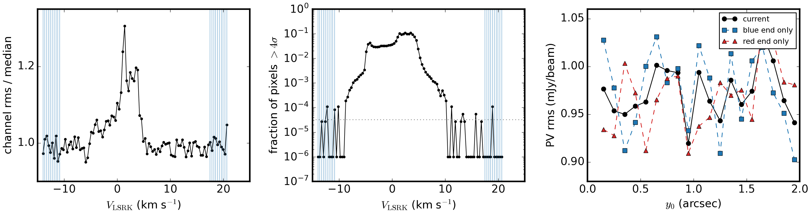
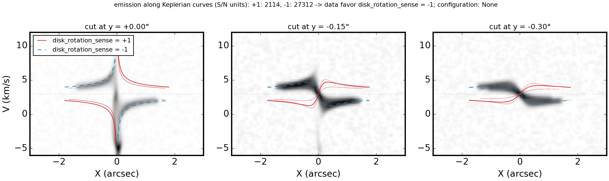
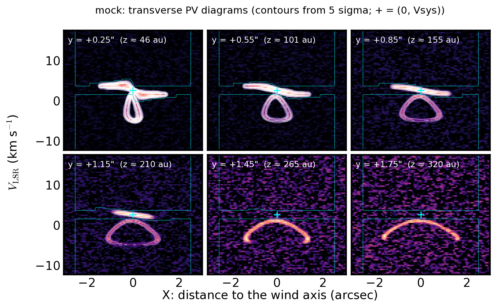
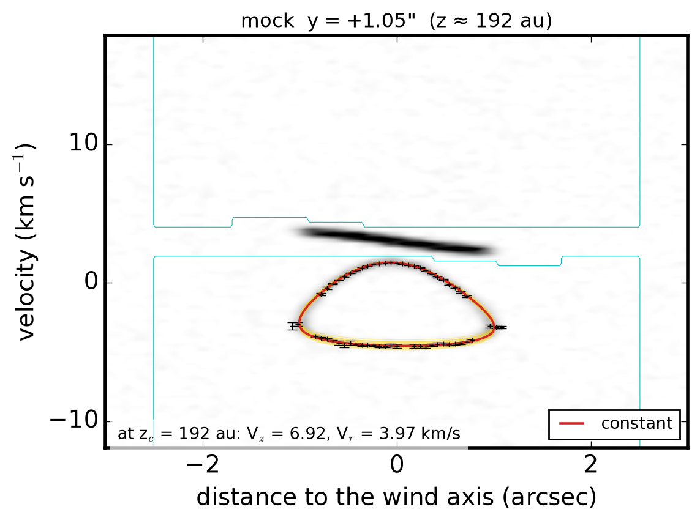
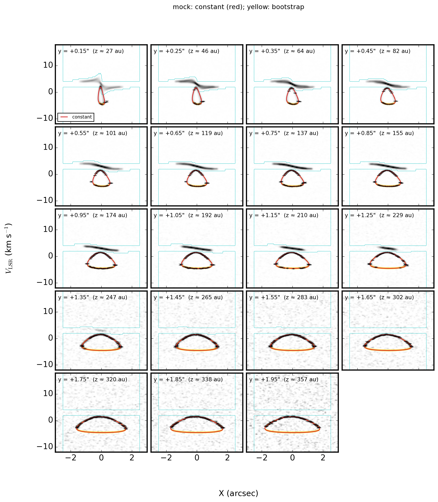
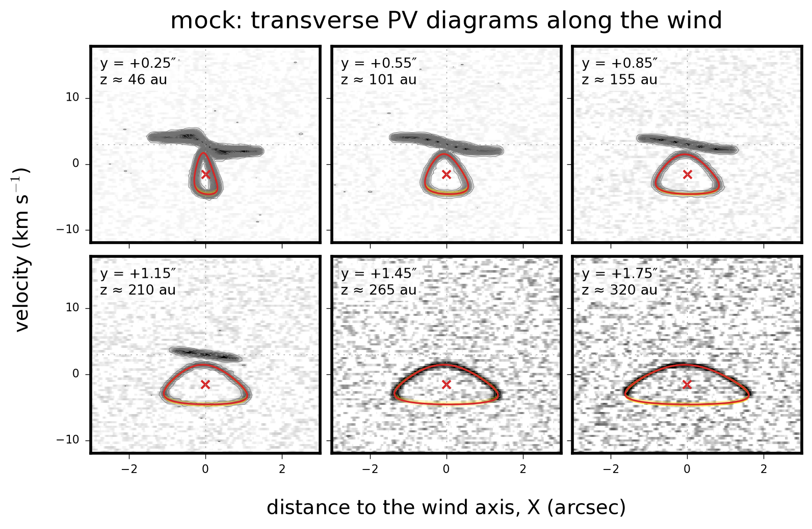
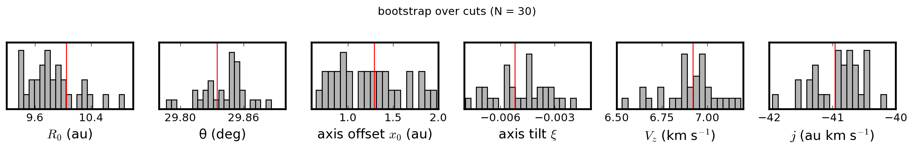
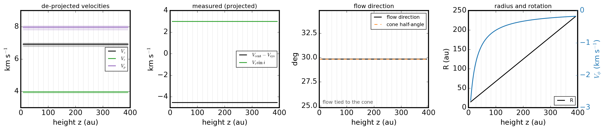
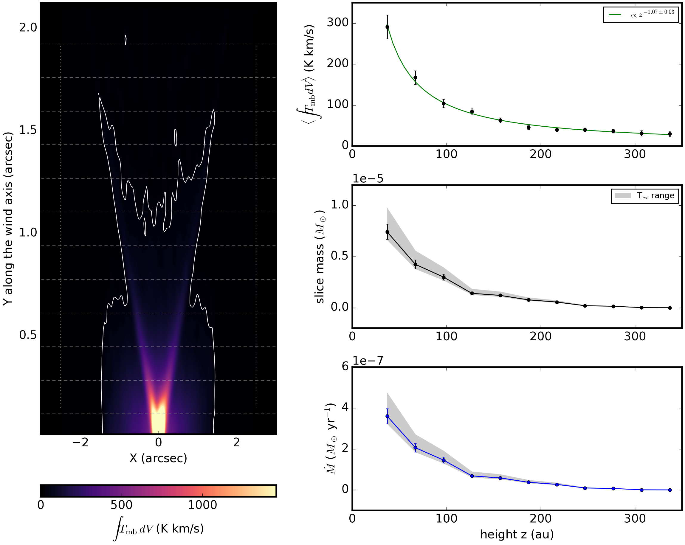

Tutorial: a synthetic wind
==========================

This tutorial makes a synthetic cube with known parameters, fits it, and checks
the result (``examples/01_quickstart_mock.py``). Every figure below is made by
the package; with ``output.fig_format = "png"`` they are written to ``output.dir``.

1. Make the cube
----------------

.. code-block:: python

   from arcwind import WindAnalysis
   from arcwind.mock import MockWind, make_mock_cube

   truth = MockWind(theta_deg=30.0, vp=8.0, j=-40.0)   # i = 49 deg, full rings
   make_mock_cube("mock_cube.fits", truth)
   cfg = truth.config("mock_cube.fits")                 # matching WindConfig
   cfg.save("mock.toml")

   wa = WindAnalysis(cfg)
   print(wa.cube)

The cube printout reports what was estimated: Vsys (3.0), the lobe orientation
(approaching, ``s = +1``) and the disk rotation sense (-1).

2. Check the inputs
-------------------

Two quick checks before fitting. ``wa.check_noise()`` shows how the noise is
measured:

   Left: rms of each channel relative to the median; the blue lines mark the
   channels used for the noise. Middle: fraction of pixels above 4 sigma in each
   channel; the dotted line is the value expected for pure noise. Noise channels
   should sit near that line, away from the line emission. Right: the noise of
   each PV diagram measured from either end of the cube; the curves should agree
   to within ~10%.

``wa.check_disk_rotation()`` tests the sign of the disk rotation against the
data:

   Keplerian curves for the two senses of rotation over PV cuts across the disk.
   The sense whose curve follows the emission (here -1, blue) is used for the
   rotation of the wind.

3. Look at the PV diagrams
--------------------------

.. code-block:: python

   wa.plot_pv_grid(show_mask=True)

   Transverse PV diagrams at increasing height. The cyan lines outline the region
   that is excluded from the traces (here the disk near Vsys); the cross marks
   (0, Vsys). The wind is the ring below Vsys; at larger heights it widens and
   its near half fades.

4. Fit
------

.. code-block:: python

   res = wa.fit("constant", radial="cone", n_boot=30)
   print(res.summary())

recovers theta = 29.8 deg (true 30), Vz = 6.92 km/s (6.93) and
j = -41 au km/s (-40).

   ``wa.plot_cut(1.05, res)``: one cut, with the traced emission (black points)
   and the fitted model (red).

   ``wa.plot_cuts(res)``: every cut with its trace (black) and the model.

   ``wa.plot_gallery(res)``: selected cuts with the best model (red), bootstrap
   models (yellow) and the ring center (cross). This is the figure for a paper.

5. Uncertainties and profiles
-----------------------------

   ``wa.plot_bootstrap(res)``: the parameters refitted after resampling the cuts
   (red: best fit). Narrow, single-peaked histograms mean a well-constrained fit.

   ``wa.plot_profiles(res)``: the fitted wind against height, with 16-84%
   bootstrap bands. From left: the de-projected velocities; the two quantities
   the data measure directly (the ring-center velocity and Vr sin i); the
   direction of the flow, here tied to the cone; the radius and the rotation
   velocity. Gray lines mark the heights of the cuts. Pass
   ``others=[res2]`` to overlay another fit (dashed).

6. Mass and mass-loss rate
--------------------------

.. code-block:: python

   mass = wa.mass(res)
   print(wa.derived(res, mass).summary())

   Left: the integrated emission of the wind, with the contour of the mass
   region and the slices in height (dashed). Right, from top: mean intensity per
   slice, mass per slice (gray: range of excitation temperatures) and mass-loss
   rate per slice.
